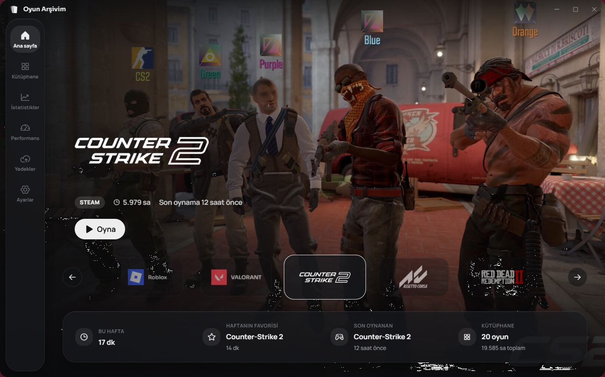
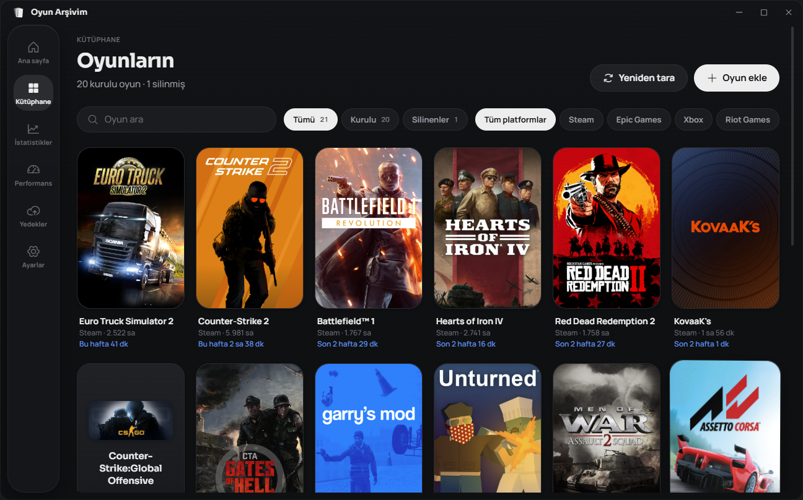
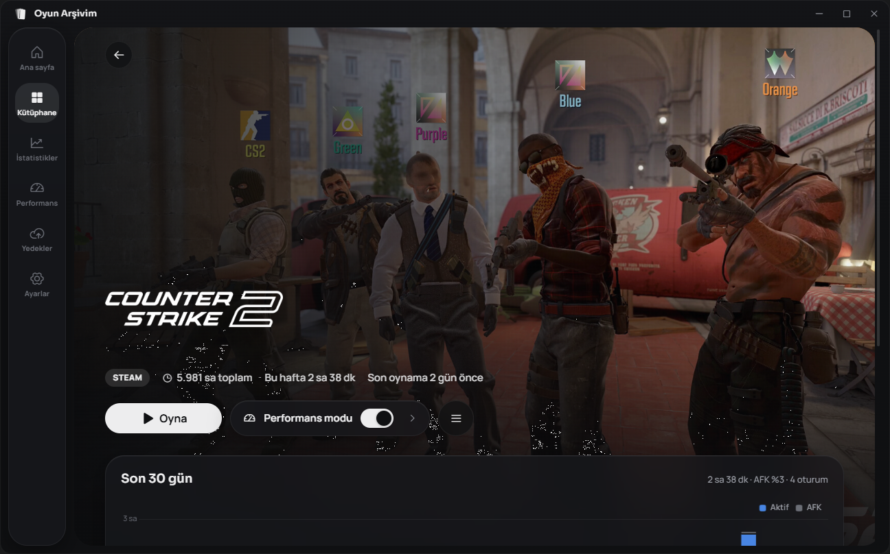
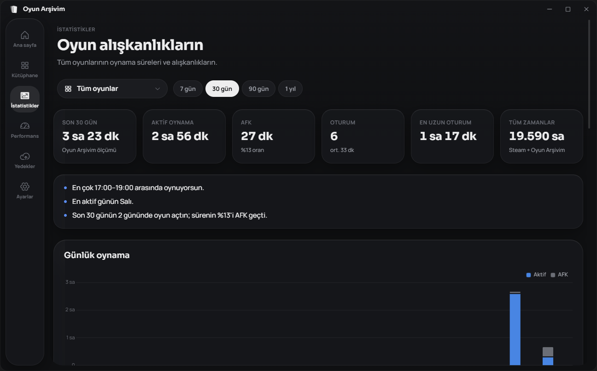
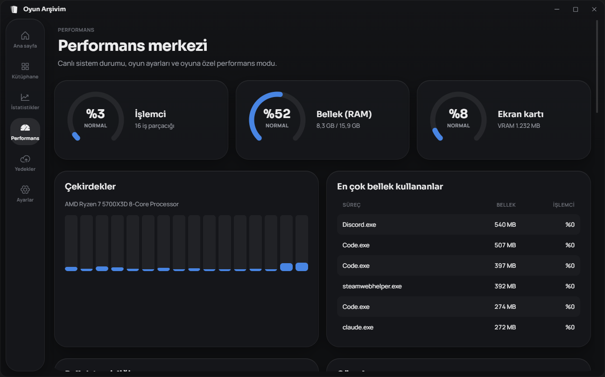

# Oyun Arşivim

**Windows için oyun kütüphanesi ve başlatıcı.** Bilgisayarındaki oyunları platformlardan otomatik bulur,
tek bir kütüphanede toplar, oynama süreni ölçer ve oyun açılınca sistemi performans moduna alır.
Tauri 2 + React ile yazılmıştır; açık kaynaktır (MIT).

[](https://github.com/X1NPAR1/oyun-arsivim/releases/latest)
[](https://github.com/X1NPAR1/oyun-arsivim/actions/workflows/ci.yml)
[](LICENSE)



## İndir

[**Son sürümü indir →**](https://github.com/X1NPAR1/oyun-arsivim/releases/latest)

| Dosya                              | Ne zaman                                                |
| ---------------------------------- | ------------------------------------------------------- |
| `Oyun.Arsivim_x.y.z_x64-setup.exe` | Önerilen kurulum (NSIS). Çift tıkla, kur.               |
| `Oyun.Arsivim_x.y.z_x64_tr-TR.msi` | Kurumsal / toplu dağıtım için Windows Installer paketi. |

Windows 10 (1809+) veya Windows 11 (64 bit) gerekir; WebView2 yoksa kurulum otomatik yükler.
Kurulum dosyaları kod imzası taşımadığı için Windows SmartScreen uyarı verebilir:
**Ek bilgi → Yine de çalıştır**.

## Özellikler

- **Otomatik tarama:** Steam, Epic Games, GOG Galaxy, EA app, Ubisoft Connect, Battle.net, Rockstar,
  Riot Games ve Xbox / Microsoft Store. İstediğin `.exe`'yi elle de ekleyebilirsin. Aynı oyun birden
  çok platformda bulunursa tek kayıt gösterilir; kurulan/silinen oyunlar kendiliğinden yansır.
- **Sinematik ana sayfa:** tam ekran oyun görselleri, yavaş yakınlaşma, oyun logoları arasında
  tekerlek ve ok tuşlarıyla gezinme.
- **Oyun detay sayfası:** karttan detaya kesintisiz geçiş, oyunun görselinden çıkarılan vurgu rengi,
  son 30 günün grafiği, oturumlar, notlar.
- **Oynama süresi:** Steam/Epic toplam süreleri + uygulamanın kendi ölçümü; AFK süresi ayrı tutulur.
- **İstatistikler:** günlük grafik, saat × gün ısı haritası, en aktif saatler ve günler, oyun bazında filtre.
- **Aynı anda tek oyun:** bir oyun açıkken başkasını başlatmak istersen sorar, istersen açık oyunu
  kapatıp yenisini açar. Sağ üstte "Oyun adı · Oynanıyor" göstergesi.
- **Performans merkezi:** canlı CPU/RAM/GPU, RAM ve bekleme belleği temizliği, otomatik RAM temizliği,
  geçici dosya (%TEMP%, Windows\Temp) temizliği, güç planı, Windows oyun ayarları ve oyuna özel
  performans profili (öncelik, güç planı, seçtiğin uygulamaları kapatma — oyun bitince her şey geri alınır).
- **Sistem tepsisi:** arka planda düşük bellekle çalışır, Windows açılışında gizli başlayabilir;
  sağ tıkla masaüstü kısayolu, klasörü aç, kaldır/yeniden kur.

## Ekran görüntüleri

| Kütüphane                                            | Oyun detayı                                            |
| ---------------------------------------------------- | ------------------------------------------------------ |
|          |         |
| **İstatistikler**                                    | **Performans merkezi**                                 |
|  |  |

## Güvenlik ve gizlilik

- Oyun dosyalarına asla dokunulmaz; yalnız okunur.
- Sistem süreçleri kapatılmaz. Performans modunda yalnız senin seçtiğin uygulamalar kapatılır;
  "oyunu kapat" yalnız o oyunun klasöründeki süreçleri sonlandırır.
- Yönetici izni gerektiren ayarlar her seferinde Windows UAC onayı ister; değişiklikler kaydedilir ve
  çökme sonrası bile geri alınır.
- Hesap, telemetri veya sunucu yok. İnternet yalnız oyun görsellerini (Steam CDN) indirmek için kullanılır;
  sonrasında önbellekten çalışır.

## Geliştirme

Gereksinimler: Node 22+, pnpm 11, Rust (stable, MSVC), Visual Studio Build Tools (C++).

```bash
pnpm install
pnpm tauri dev      # geliştirme
pnpm check          # tüm testler + lint (TypeScript, ESLint, Prettier, Vitest, rustfmt, clippy, cargo test)
pnpm tauri build    # kurulum dosyaları (NSIS .exe + .msi)
```

Mimari: [docs/ARCHITECTURE.md](docs/ARCHITECTURE.md) · Platform tespiti: [docs/PLATFORMS.md](docs/PLATFORMS.md) ·
Tasarım sistemi: [docs/DESIGN_SYSTEM.md](docs/DESIGN_SYSTEM.md) · Katkı: [CONTRIBUTING.md](CONTRIBUTING.md) ·
Değişiklikler: [CHANGELOG.md](CHANGELOG.md)

## Lisans

[MIT](LICENSE). Kullanılan kütüphane, font ve ikonların lisansları: [docs/THIRD_PARTY.md](docs/THIRD_PARTY.md).
Oyun adları, logoları ve görselleri sahiplerinindir; uygulama bunları yalnız kullanıcının kendi
bilgisayarında, kütüphanesini göstermek için önbelleğe alır.
